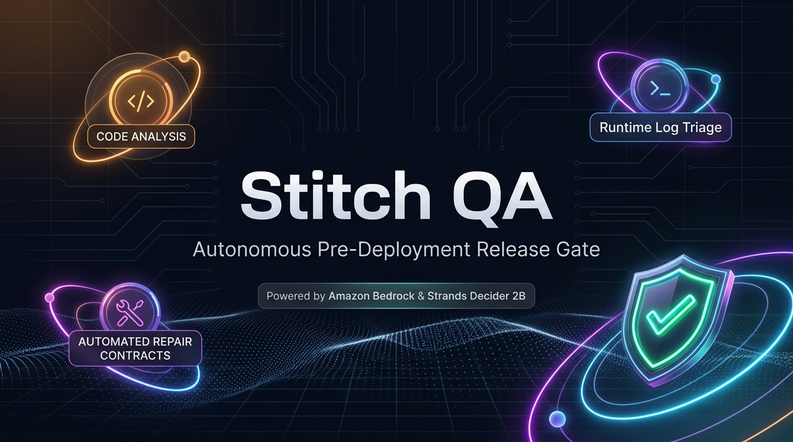
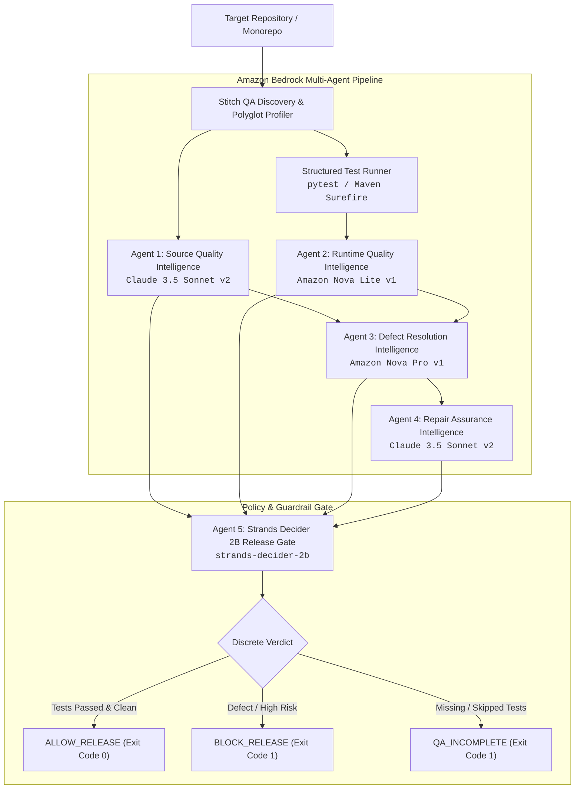

<p align="center">
  
</p>

# Stitch QA: Autonomous Multi-Agent Pre-Deployment Release Gate

[](https://aws.amazon.com/bedrock/)
[](https://builder.aws.com)
[](https://python.org)
[](https://github.com/hashan-7/stitch-qa-release-gate/actions/workflows/tests.yml)
[](https://github.com/features/actions)
[](LICENSE)

> Built for the **Agent Experience Hackathon: Strands Decider** on AWS Builder Center.  
> **Tags:** `#strands-decider-2b` `#policy` `#guardrails`

**Stitch QA** is an enterprise-grade, multi-agent pre-deployment release gate that orchestrates **Amazon Bedrock foundation models** and **Strands Decider 2B** to turn raw code, execution logs, and runtime evidence into rigorous release decisions.

Instead of relying on fragile string-matching or raw CI script exit codes, Stitch QA deploys a specialized multi-agent pipeline that reviews source code, executes structured tests, classifies root causes, plans surgical repair contracts, and hands a calibrated decision vector to **Strands Decider 2B** for an authoritative release gate verdict: **`ALLOW_RELEASE`**, **`BLOCK_RELEASE`**, or **`QA_INCOMPLETE`**.

---

## Table of Contents

- [Key Capabilities](#key-capabilities)
- [AI Multi-Agent Architecture](#ai-multi-agent-architecture)
- [Reusable Strands Decider 2B Decision Pattern](#reusable-strands-decider-2b-decision-pattern)
- [Supported Project Types & Polyglot Monorepos](#supported-project-types--polyglot-monorepos)
- [Release Gate Decision Matrix](#release-gate-decision-matrix)
- [Quick Start](#quick-start)
- [GitHub Actions Integration & Native Step Summary](#github-actions-integration--native-step-summary)
- [Docker Usage](#docker-usage)
- [Configuration & Environment Variables](#configuration--environment-variables)
- [Zero-Dependency Offline Mode](#zero-dependency-offline-mode)
- [Safety Guarantees](#safety-guarantees)
- [Validation & Unit Tests](#validation--unit-tests)
- [License](#license)

---

## Key Capabilities

| Capability | Description |
| --- | --- |
| **Autonomous Multi-Agent Review** | Orchestrates 5 specialized AI agents across Amazon Bedrock and Strands Decider 2B. |
| **Discrete Release Gating** | Strands Decider 2B evaluates calibrated confidence scores (e.g. `0.97`, `0.99`) to enforce CI exit codes (`0` or `1`). |
| **Polyglot Monorepo Profiling** | Detects mixed-language repositories (e.g. Python + Node.js) and isolates unverified language scopes without pipeline breakage. |
| **Failure Origin Classification** | Intelligently isolates **Application Defects** from **Environment / Build Blocker** failures. |
| **Surgical Repair Contracts** | Generates prioritized, non-destructive repair contracts preserving surrounding business logic. |
| **Native GitHub Actions Step Summary** | Renders beautiful, markdown-rich Executive Summaries directly inside GitHub Actions run dashboards. |
| **Zero-Setup Offline Fallback** | Runs 100% offline using a built-in deterministic engine when AWS keys or internet connectivity are unavailable. |
| **Advisory Safety Policy** | **Auto Apply is permanently `False`**. Never mutates developer code without explicit human review. |

---

## AI Multi-Agent Architecture

Stitch QA coordinates a heterogeneous multi-agent pipeline pairing Amazon Bedrock foundation models with the Strands Decider 2B decision engine:



### Agent Roles & Model Mapping

| Agent Role | Model ID | Primary Responsibility |
| --- | --- | --- |
| **1. Source Quality Intelligence Analyst** | `us.anthropic.claude-3-5-sonnet-20241022-v2:0` | Deep AST code inspection, architectural anti-patterns, and vulnerability detection. |
| **2. Runtime Quality Intelligence Analyst** | `amazon.nova-lite-v1:0` | High-token ingestion of execution logs, traceback isolation, and failure classification. |
| **3. Defect Resolution Intelligence Analyst** | `amazon.nova-pro-v1:0` | Synthesis of root causes into prioritized, bounded repair contracts. |
| **4. Repair Assurance Intelligence Analyst** | `us.anthropic.claude-3-5-sonnet-20241022-v2:0` | Generation of non-destructive code patches and regression verification guidance. |
| **5. Release Gate Decider** | `StrandsAgents/strands-decider-2B-hobson-v21` | Evaluates multi-agent evidence vectors to render calibrated release gate decisions. |

---

## Reusable Strands Decider 2B Decision Pattern

As required by the **Agent Experience Hackathon**, Stitch QA provides a reusable decision pattern demonstrating how builders can decouple high-stakes release policies from slow, non-deterministic text-generation LLMs.

### 1. Pattern Classification
* **Primary Pattern:** `#policy` (Release gating policy evaluation)
* **Secondary Pattern:** `#guardrails` (Pre-deployment runtime verification guardrail)
* **Execution Latency:** ~115ms (Evaluated locally on client hardware)
* **Cost:** $0.00 token cost for the discrete binary gate decision

### 2. Typed ChoiceQuestion & InterventionHandler Pattern

```python
from stitch_cli.decider_agent import (
    ReleaseGateInterventionHandler,
    StrandsDeciderAgent,
    DeciderVerdict,
)
from strands.interventions import InterventionHandler, Proceed, Deny, Guide
from strands_decider.schema import ChoiceQuestion

# 1. Initialize the official Strands Intervention Handler
handler = ReleaseGateInterventionHandler()

# 2. Formulate the typed ChoiceQuestion schema
question = handler.build_choice_question("test_result=PASS, origin=NONE, critical_risks=0")

# 3. Intercept deployment using Strands Decider 2B
verdict: DeciderVerdict = handler.evaluate(
    test_result="PASS",                  # "PASS" | "FAIL" | "NOT_RUN"
    failure_origin="NONE",               # "APPLICATION_DEFECT" | "ENVIRONMENT" | "NONE"
    source_findings=[],                  # List of source quality risk dicts
    repair_contracts=[],                 # List of active repair contracts
    has_tests=True,                      # Whether runtime test coverage was detected
    unsupported_scopes=["Node.js"],      # Any unverified ecosystem scopes
    component_name="PaymentService",     # Optional component label
)

print(f"Gate Verdict:        {verdict.verdict}")             # e.g., "ALLOW_RELEASE"
print(f"Intervention Action: {verdict.intervention_action}")  # e.g., "Proceed"
print(f"Confidence Score:    {verdict.confidence:.2f}")       # e.g., 0.97
print(f"Choice Distribution: {verdict.probabilities}")       # e.g., {'ALLOW_RELEASE': 0.974, ...}
print(f"Exit Code:          {0 if verdict.verdict == 'ALLOW_RELEASE' else 1}")
```

---

## Supported Project Types & Polyglot Monorepos

Stitch QA automatically detects project ecosystems and maps source directories, test suites, and build files:

| Project Type | Status | Detection Indicator | Active Execution Profile |
| --- | --- | --- | --- |
| **Python Project** | Supported | `requirements.txt`, `pyproject.toml`, `*.py` | `PYTHON_PYTEST` |
| **Java Maven Project** | Supported | `pom.xml` | `MAVEN_SUREFIRE` |
| **Polyglot Monorepo** | Supported | Multiple ecosystem markers (e.g. Python + Node.js) | Active execution for supported profiles; graceful isolation for unverified scopes. |
| **Node.js / TypeScript** | Planned | `package.json`, `tsconfig.json` | Safely skipped with exit code 0 (`Unverified Language Scope`). |
| **Go / Rust / .NET** | Planned | `go.mod`, `Cargo.toml`, `*.csproj` | Safely skipped with exit code 0 (`Unverified Language Scope`). |

---

## Release Gate Decision Matrix

| Scenario | Test Status | Evidence Completeness | Strands Decider Verdict | CI Exit Code | Release Outcome |
| :--- | :--- | :--- | :--- | :--- | :--- |
| **Clean Passing Suite** | `PASS` (100%) | `COMPLETE` | `ALLOW_RELEASE` | **`0`** | **Ship to Production ✅** |
| **Runtime Defect Encountered** | `FAIL` | `COMPLETE` | `BLOCK_RELEASE` | **`1`** | **Deployment Blocked ⛔** |
| **Missing / No Tests Detected** | `SKIPPED` | `SOURCE_ONLY` | `QA_INCOMPLETE` | **`1`** | **Deployment Blocked ⛔** |
| **Build Tool / Environment Issue** | `ERROR` | `PARTIAL` | `QA_INCOMPLETE` | **`1`** | **Fix Environment ⛔** |
| **Polyglot Monorepo (Pass + Note)** | `PASS` | `COMPLETE` | `ALLOW_RELEASE` (with scope note) | **`0`** | **Ship with Warning ⚠️** |
| **Unsupported Language Only** | `SKIPPED` | `N/A` | Clean Skip (`0`) | **`0`** | **No Pipeline Failure ✅** |

---

## Quick Start

### 1. Installation

```bash
git clone https://github.com/hashan-7/stitch-qa-release-gate.git
cd stitch-qa-release-gate
python -m venv .venv

# Windows PowerShell:
.\.venv\Scripts\Activate.ps1

# Linux / macOS:
source .venv/bin/activate

python -m pip install --upgrade pip
python -m pip install -e ./cli
```

### 2. Basic Commands

```bash
# Verify Amazon Bedrock and Strands Decider connectivity & model tiers
stitch check-bedrock

# (Optional) Launch local Strands Decider System 1 HTTP server
stitch decider-serve --port 8000

# Discover project structure and static mappings
stitch scan .

# Run static source review and compatible automated test suites
stitch scan . --run

# Full multi-agent evaluation: source review, test execution, log analysis, and repair planning
stitch scan . --run --analyze --repair --code-fix
```

---

## GitHub Actions Integration & Native Step Summary

Stitch QA includes native integration with GitHub Actions. It writes formatted reports directly to **`$GITHUB_STEP_SUMMARY`**, providing an executive dashboard directly on your Pull Request or Commit run page without requiring external servers.

```yaml
name: Stitch QA Release Gate

on:
  push:
    branches: [ main ]
  pull_request:
    branches: [ main ]

jobs:
  stitch-qa-gate:
    runs-on: ubuntu-latest
    steps:
      - name: Checkout Code
        uses: actions/checkout@v4

      - name: Set up Python 3.11
        uses: actions/setup-python@v5
        with:
          python-version: '3.11'

      - name: Install Stitch QA
        run: |
          pip install git+https://github.com/hashan-7/stitch-qa-release-gate.git#subdirectory=cli

      - name: Run Stitch QA Gate
        env:
          AWS_ACCESS_KEY_ID: ${{ secrets.AWS_ACCESS_KEY_ID }}
          AWS_SECRET_ACCESS_KEY: ${{ secrets.AWS_SECRET_ACCESS_KEY }}
          AWS_DEFAULT_REGION: us-east-1
        run: |
          stitch scan . --run --analyze --repair --code-fix

      - name: Upload QA Report Artifacts
        if: always()
        uses: actions/upload-artifact@v4
        with:
          name: stitch-qa-reports
          path: |
            STITCH_QA_REPORT.md
            STITCH_QA_REPORT.json
```

---

## Docker Usage

Stitch QA is packaged as an isolated Docker container with pre-installed Java, Python, and Maven runtimes:

```bash
# Build the container image locally
docker build -t stitch-qa:latest .

# Run a scan against any local project directory
docker run --rm -v "${PWD}:/project" stitch-qa:latest scan /project --run --analyze --repair
```

---

## Configuration & Environment Variables

Stitch QA supports custom model configurations via environment variables or a local `.env` file (see [`.env.example`](.env.example)):

```bash
# Copy template to .env
cp .env.example .env
```

| Variable | Default Value | Purpose |
| --- | --- | --- |
| `AWS_ACCESS_KEY_ID` | `None` (triggers offline mode) | AWS Access Key ID for Bedrock API access. |
| `AWS_SECRET_ACCESS_KEY` | `None` (triggers offline mode) | AWS Secret Access Key for Bedrock API access. |
| `AWS_DEFAULT_REGION` | `us-east-1` | Target AWS region with Bedrock model access. |
| `BEDROCK_MODEL_SOURCE_QUALITY` | `us.anthropic.claude-3-5-sonnet-20241022-v2:0` | Foundation model for Agent 1 & Agent 4. |
| `BEDROCK_MODEL_RUNTIME_QUALITY` | `amazon.nova-lite-v1:0` | Foundation model for Agent 2 log analysis. |
| `BEDROCK_MODEL_DEFECT_RESOLUTION`| `amazon.nova-pro-v1:0` | Foundation model for Agent 3 repair planning. |
| `STRANDS_DECIDER_MODEL` | `StrandsAgents/strands-decider-2B-hobson-v21` | Open release gate decision model. |
| `STITCH_MOCK_BEDROCK` | `false` | Set to `true` to force offline mode regardless of keys. |

---

## Zero-Dependency Offline Mode

Stitch QA is designed with **graceful fault tolerance**:
* **Air-Gapped & Offline Ready:** If AWS keys are not detected, internet connectivity drops, or Bedrock API calls experience a timeout, Stitch QA automatically falls back to its **`bedrock-deterministic-offline`** engine.
* **Zero Crashing:** The entire pipeline executes locally without throwing unhandled exceptions.
* **Full Evaluation:** Generates AST findings, JUnit evidence parsing, repair contracts, and calibrated Strands Decider verdicts completely offline.

---

## Safety Guarantees

* **Non-Destructive:** Auto Apply is permanently set to `False`. Stitch QA never modifies source files or commits code automatically.
* **Boundary Protection:** Repair guidance is restricted strictly to application source boundaries, preserving existing APIs and passing regression tests.
* **Zero Secret Leakage:** `.env`, `.env.*`, keys, and credentials are listed in `.gitignore` and `.dockerignore`.

---

## Validation & Unit Tests

Stitch QA maintains a comprehensive automated test suite covering all multi-agent services, Strands Decider intervention handlers, and polyglot parsers:

```bash
# Run all unit and integration tests
pytest tests/ cli/tests/ -v
```

```text
tests/test_bedrock_service.py .........                                  [ 14%]
tests/test_decider_agent.py ........                                      [ 27%]
tests/test_e2e_pipeline.py ....                                          [ 34%]
tests/test_github_step_summary.py ...                                    [ 39%]
tests/test_polyglot_scanner.py ......                                    [ 49%]
tests/test_runtime_evidence.py ..                                        [ 52%]
tests/test_test_report_parser.py ....                                    [ 59%]
cli/tests/test_maven_runtime_classification.py .....                     [ 67%]
cli/tests/test_repair_guidance_v2.py ...................                 [ 96%]
cli/tests/test_runtime_fallback.py ..                                    [100%]
============================= 61 passed in 5.48s ==============================
```

---

## License

This project is licensed under the **MIT License**. See [`LICENSE`](LICENSE) for details.

---

<div align="center">

**Developed with 💜 by H7**

</div>
