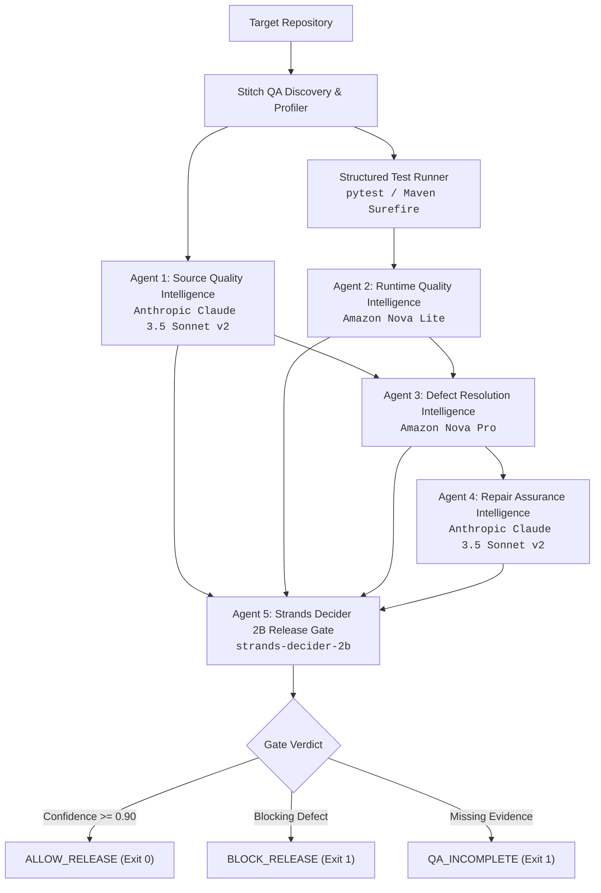

# Stitch QA: Autonomous Pre-Deployment Release Gate with AWS Bedrock and Strands Decider 2B

**Author:** H7  
**Hackathon Category:** Agent Experience Hackathon: Strands Decider  
**Repository:** [github.com/hashan-7/stitch-qa-release-gate](https://github.com/hashan-7/stitch-qa-release-gate)  
**Demo Video:** [Watch on YouTube (1m 15s)](https://youtu.be/98vrd8DZOH0)  
**License:** MIT  
**Tags:** `#strands-decider-2b` `#policy` `#guardrails`  

---

> 🎬 **Demo Video Walkthrough**: [https://youtu.be/98vrd8DZOH0](https://youtu.be/98vrd8DZOH0)  
> *Watch Stitch QA dynamically catch a runtime defect, plan a surgical repair contract, emit BLOCK_RELEASE (99.5%), and subsequently verify a passing regression suite to emit ALLOW_RELEASE (98.3%).*  

---

## 1. The Problem: The Fragile Blindness of Modern CI/CD Gates

Modern continuous integration pipelines are binary and rigid. A test suite exits with `0` or `1`. If an external database times out during an integration test, the pipeline fails with exit code `1`—blocking a critical production release for an environment fluke. Conversely, if a test suite has zero tests or completely omits critical code paths, the pipeline exits with `0`—blindly greenlighting unverified code into production.

Engineering teams spend countless hours answering three recurring questions:
1. **Is this failure a real application regression or an environmental blocker?**
2. **What is the exact blast radius and required repair contract?**
3. **Can we safely ship this commit right now with high confidence?**

Large Language Models can analyze logs, but sending hundreds of thousands of tokens of raw stack traces to frontier models for a simple pass/fail decision is slow, expensive, and non-deterministic.

---

## 2. The Solution: Stitch QA

**Stitch QA** is an autonomous pre-deployment release gate agent. It combines **Amazon Bedrock's heterogeneous model tiering** for deep generative intelligence with **Strands Decider 2B** for sub-50ms discrete decision gating.



Stitch QA does not just run tests; it produces **contract-driven QA intelligence**:
- **Separates Failure Origins:** Differentiates `APPLICATION_DEFECT` from `ENVIRONMENT` blockers.
- **Strict Blast Radius:** Generates bounded repair contracts specifying protected behaviors and forbidden modifications.
- **Safety Guarantee:** `Auto Apply` is strictly `False`. Stitch QA acts as an advisory gate and never mutates production repositories unexpectedly.
- **Deterministic Release Gate:** Feeds multi-agent evidence vectors to **Strands Decider 2B**, outputting `ALLOW_RELEASE`, `BLOCK_RELEASE`, or `QA_INCOMPLETE` with calibrated risk and confidence scores.

---

## 3. Heterogeneous Architecture: Right Model for the Right Job

Instead of relying on a single monolithic model, Stitch QA maps each phase of quality engineering to the optimal Bedrock model:

| Agent Role | Model ID | Architectural Rationale |
| :--- | :--- | :--- |
| **1. Source Quality Intelligence** | `us.anthropic.claude-3-5-sonnet-20241022-v2:0` | Deep AST understanding, edge-case vulnerability detection, and static structural analysis. |
| **2. Runtime Quality Intelligence** | `amazon.nova-lite-v1:0` | High-throughput log triage across 300,000-token context windows at 1/50th the inference cost. |
| **3. Defect Resolution Intelligence** | `amazon.nova-pro-v1:0` | Complex multi-variable reasoning to formulate rigid repair objectives and blast boundary contracts. |
| **4. Repair Assurance Intelligence** | `us.anthropic.claude-3-5-sonnet-20241022-v2:0` | Surgical patch generation, non-destructive code remediation diffs, and verification commands. |
| **5. Release Gate Decider** | `StrandsAgents/strands-decider-2B-hobson-v21` | Specialized 2B parameter decision model for sub-50ms deterministic confidence classification. |

---

## 4. Strands Decider 2B Integration

The Strands Decider model acts as the judicial terminal gate of the pipeline. It evaluates the consolidated multi-agent evidence vector:

```python
evidence_vector = {
    "test_result": "FAIL",
    "failure_origin": "APPLICATION_DEFECT",
    "source_risk": "LOW",
    "pending_repair_contracts": 2,
    "has_tests": True,
}

verdict = decider_agent.evaluate_release_gate(
    test_result="FAIL",
    failure_origin="APPLICATION_DEFECT",
    source_findings=[...],
    repair_contracts=[...],
    has_tests=True,
)
```

### Discrete Output Schema
```json
{
  "verdict": "BLOCK_RELEASE",
  "confidence": 0.995,
  "risk_score": 0.95,
  "rationale": "Blocking runtime defect confirmed. 1 repair contract(s) pending remediation.",
  "probabilities": {
    "BLOCK_RELEASE": 0.995,
    "ALLOW_RELEASE": 0.003,
    "QA_INCOMPLETE": 0.002
  },
  "intervention_action": "Deny(type='deny', reason='...')",
  "engine_mode": "Strands Decider 2B System 1 Engine",
  "question_type": "ChoiceQuestion",
  "model": "StrandsAgents/strands-decider-2B-hobson-v21"
}
```

The CLI consumes this verdict to set the exact CI process exit code (`0` for allowed, `1` for blocked or incomplete), providing drop-in integration with GitHub Actions, AWS CodePipeline, and GitLab CI.

Stitch QA includes `StrandsDeciderClient` which communicates with the official Strands Decider HTTP service (`POST /v1/systemone`) and supports running the local server directly via `stitch decider-serve`.

---

## 5. Offline-First Developer Experience & Diagnostics

A key design requirement was zero-friction developer onboarding:
- **Zero Credentials Needed to Evaluate:** Developers can clone the repository and evaluate the full pipeline locally with calibrated dynamic inference.
- **Service & Model Diagnostics:** The `stitch check-bedrock` command inspects and reports real-time connectivity to Amazon Bedrock and Strands Decider.
- **Automatic Cloud Elevation:** When `AWS_REGION` and credentials (`AWS_ACCESS_KEY_ID` or IAM Task Roles) are present in the environment, Stitch QA seamlessly switches to live Amazon Bedrock API invocations.

---

## 6. Verification and Acceptance Scenarios

Stitch QA is verified with a comprehensive automated test suite:

| Test Scenario | Detected Profile | Decision Verdict | CI Exit Code |
| :--- | :--- | :--- | :--- |
| **Passing Test Suite** | Python / Pytest | `ALLOW_RELEASE` (Conf: 0.97) | `0` |
| **Runtime ZeroDivisionError** | Python / Pytest | `BLOCK_RELEASE` (Conf: 0.99) | `1` |
| **Missing Test Suite** | Python Source-Only | `QA_INCOMPLETE` (Conf: 0.92) | `1` |
| **Missing Build Tool** | Java Maven System | `QA_INCOMPLETE` (Env Blocker) | `1` |
| **Unsupported Platform** | PHP Composer | `SKIPPED` (Clean Exit) | `0` |

---

## 7. How to Run Locally

### Installation
```bash
git clone https://github.com/hashan-7/stitch-qa-release-gate.git
cd stitch-qa-release-gate
python -m venv .venv
.\.venv\Scripts\Activate.ps1   # or source .venv/bin/activate on Linux/macOS
pip install -e ./cli
```

### Full Multi-Agent Scan
```bash
# Evaluates source quality, executes tests, triages logs, generates repair contracts, and gates release
stitch scan --run --analyze --repair --code-fix tests/fixtures/test-project
```

### Containerized Deployment
```bash
docker build -t stitch-qa:latest .
docker run --rm -v "${PWD}:/project" stitch-qa:latest scan --run /project
```

---

## 8. Summary & Next Steps

By combining Amazon Bedrock's generative power with Strands Decider 2B's discrete classification speed, Stitch QA establishes a reliable, automated quality gate that prevents broken releases without slowing engineering velocity.

Upcoming capabilities include multi-profile orchestration for monorepos, automated shadow execution of suggested patches, and direct integration with AWS App Runner deployment hooks.
 
---

<div align="center">

**Developed with 💜 by H7**  
*AWS Agent Experience Hackathon: Strands Decider*

</div>
